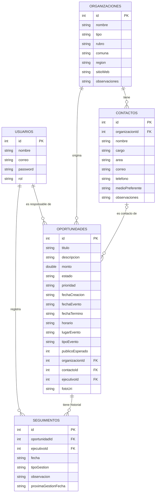

# Radar de Eventos

Aplicación móvil Android para gestionar oportunidades de activación y convenios corporativos: registrar eventos y organizaciones, asignarlos a un equipo comercial, darles seguimiento y detectar con anticipación cuáles requieren atención.

Proyecto desarrollado para la **Evaluación Parcial 2** de la asignatura **DSY1105 · Desarrollo de Aplicaciones Móviles** (Duoc UC), a partir del caso "Gestión móvil de oportunidades y activaciones corporativas".

## Integrantes

| Nombre |
|---|---|
| [Nombre Apellido 1] Axel Juris
| [Nombre Apellido 2] Cristobal Perez

- **Equipo N°:** 13
- **Sección / Sede:** 010D
- **Docente:** CHRISTIAN EDUARDO ACUNA SANDOVAL
- **Tablero Trello:**

## Contexto del problema

Una agencia de marketing y beneficios corporativos identifica eventos (ferias, jornadas de beneficios, actividades municipales, etc.) de forma manual, con información dispersa entre redes sociales, correos y registros personales. Eso provoca que muchas oportunidades se detecten tarde o se pierdan. La app centraliza el registro, la priorización y el seguimiento, y destaca lo próximo a ocurrir y lo atrasado.

## Funcionalidades implementadas

### Usuarios, roles y permisos
- Inicio y cierre de sesión con cuentas locales ficticias.
- Dos roles, con pantallas y opciones distintas: **Ejecutivo Comercial** y **Supervisor Comercial**.
- El ejecutivo ve solo las oportunidades asignadas a él. El supervisor ve todas.
- Control de sesión: si no hay usuario activo (por ejemplo, el sistema cerró la app en segundo plano), se vuelve al inicio de sesión.

### Oportunidades
- Crear y **editar** oportunidades con fecha, horario, lugar, tipo de evento, público esperado, prioridad y costo referencial ficticio.
- Asociación a una organización y, opcionalmente, a un contacto de esa organización.
- Lista con búsqueda por nombre u organización y filtros por **estado** y **prioridad**.
- Pantalla de detalle con la información completa y el historial de gestiones.
- Cambio de estado respetando permisos y transiciones (ver reglas de negocio).
- El supervisor asigna y reasigna oportunidades a ejecutivos.

### Organizaciones y contactos
- Registro de organizaciones y consulta de las ya registradas.
- Registro de contactos asociados a una organización (la organización, el área y el medio preferente se eligen de listas, así no se puede crear un contacto huérfano). Consulta de los contactos de cada organización.

### Seguimiento
- Registro de gestiones (llamada, reunión, correo, visita) con observación y fecha de la próxima gestión.
- Historial de gestiones por oportunidad, con su autor.

### Dashboard y panel del supervisor
- Dashboard en Inicio, según el rol: oportunidades activas, eventos próximos (14 días), seguimientos pendientes, **gestiones atrasadas** y oportunidades sin gestión.
- Panel del supervisor, con consulta global, carga por ejecutivo y oportunidades sin asignar. Es una pantalla restringida: un ejecutivo no puede acceder.

### Recursos nativos
- **Cámara:** captura de una foto como evidencia de la oportunidad, con vista previa. La foto se conserva asociada a su oportunidad.
- **Calendario:** agendar el evento (con fecha y hora) o una próxima gestión en el calendario del dispositivo.

## Reglas de negocio

**Transiciones de estado**

| Estado actual | Ejecutivo puede | Supervisor puede |
|---|---|---|
| Nueva | Iniciar gestión | Iniciar gestión, descartar |
| En gestión | Nada (no confirma ni descarta) | Confirmar, descartar |
| Confirmada / Descartada | Nada | Reabrir (vuelve a En gestión) |

**Edición de una oportunidad**
- El supervisor puede editar cualquiera.
- El ejecutivo solo puede editar las suyas, y únicamente mientras estén en estado Nueva o En gestión.

Estas reglas se comprueban en el ViewModel y no solo en la pantalla, para que no se puedan saltar desde la interfaz.

## Arquitectura

La app sigue el patrón **MVVM** con una capa de datos separada:

```
Pantalla (Composable)  ──observa──▶  ViewModel  ──usa──▶  Repository  ──usa──▶  DAO  ──▶  Room (SQLite)
      ▲                                  │
      └────────── UiState (StateFlow) ───┘
```

- **UI (`screens`, `components`):** composables que solo muestran el estado y avisan eventos al ViewModel. No contienen lógica de validación.
- **ViewModel (`viewmodel`):** guarda el estado de cada pantalla en un `UiState`, expuesto como `StateFlow`. Orquesta validaciones, permisos y llamadas al repositorio.
- **Validación (`validation`):** objetos independientes de la interfaz, con las reglas de cada formulario y las reglas de estado y permisos.
- **Repository (`data/CrmRepository`):** único punto de acceso a los datos.
- **Datos (`data`, `dataDao`):** entidades, DAOs y la base de datos Room.

### Estructura de carpetas

```
app/src/main/java/com/example/proyecto_evaluacion/
├── components/    Componentes reutilizables (campo validado, selector, barra superior, etiquetas)
├── data/          Entidades, base de datos, repositorio y sesión
├── dataDao/       DAOs de Room
├── fechas/        Utilidades de fechas, cámara (evidencias) y calendario
├── navegacion/    NavHost y rutas
├── screens/       Pantallas
├── ui/theme/      Colores, tipografía y tema
├── validation/    Validadores y reglas de negocio
└── viewmodel/     ViewModels y UiState
```

### Pantallas

| Pantalla | Descripción |
|---|---|
| Inicio de sesión | Acceso con cuenta local |
| Inicio (dashboard) | Resumen según el rol y accesos directos |
| Lista de oportunidades | Búsqueda y filtros |
| Detalle de oportunidad | Datos, estado, foto, calendario, asignación e historial |
| Formulario de oportunidad | Crear y editar |
| Formulario de organización | Registro y consulta |
| Formulario de contacto | Registro y consulta por organización |
| Panel del supervisor | Consulta global y asignación |

## Modelo de datos

La base de datos local (Room / SQLite) tiene 5 tablas relacionadas por claves foráneas.



**Decisiones de diseño**
- **Normalización (hasta 3FN):** cada dato de organización, contacto o usuario vive en una sola tabla y se referencia por su identificador. Una oportunidad no copia el nombre de la organización ni del ejecutivo, solo guarda sus claves.
- **Historial conservado:** las gestiones se guardan en su propia tabla y nunca se sobrescriben. Cada una conserva su autor y su fecha.
- **Contacto opcional:** una oportunidad pertenece a una organización, y el contacto es opcional. La interfaz solo ofrece los contactos de la organización elegida, por eso no pueden quedar inconsistentes.
- **Responsable opcional:** una oportunidad creada por el supervisor queda sin responsable hasta que la asigna. Por eso `ejecutivoId` admite valor nulo.
- **Fotos:** el archivo se guarda en el almacenamiento privado de la app (`filesDir/evidencias`) y la tabla guarda solo su ruta.

## Validaciones

Todas las reglas viven en el paquete `validation`, separadas de la interfaz:
- Campos obligatorios y longitudes mínimas y máximas.
- Formatos de correo, teléfono (9 a 11 dígitos), fecha (`dd/mm/aaaa` real, no solo con formato) y horario (`HH:mm`).
- Valores numéricos: público esperado mayor a 0 y costo no negativo.
- Reglas de negocio: la fecha de término no puede ser anterior a la de inicio, y la próxima gestión no puede ser anterior a hoy.

Cada campo muestra su mensaje bajo el campo, borde de error e ícono. Si falla una validación, los valores ingresados se mantienen.

## Diseño y animaciones

- **Jetpack Compose** con **Material Design 3**.
- Tema propio en `ui/theme` (turquesa, en modo claro y oscuro), sin color dinámico del sistema.
- Colores semánticos centralizados para los estados, las prioridades, el éxito y la advertencia. Las pantallas no usan colores hexadecimales.
- Jerarquía tipográfica con `MaterialTheme.typography`.
- Animaciones: `AnimatedVisibility` (mensajes y formularios), `animateColorAsState` (color del encabezado según el estado), `animateContentSize` y `animateItem` (tarjetas y listas).
- Estados vacíos, indicadores de carga y avisos de confirmación o error en cada operación.

## Tecnologías

| Tecnología | Uso |
|---|---|
| Kotlin | Lenguaje |
| Jetpack Compose y Material 3 | Interfaz |
| Navigation Compose | Navegación entre pantallas |
| ViewModel, `StateFlow` y corrutinas | Estado y operaciones asíncronas |
| Room (con KSP) | Persistencia local |
| Coil | Vista previa de las fotos |
| `FileProvider` y `TakePicture` | Cámara |
| `Intent` de calendario | Integración con el calendario |

Las versiones exactas están en `gradle/libs.versions.toml`.

## Cómo ejecutar el proyecto

**Requisitos**
- Android Studio reciente, con conexión a internet para la primera sincronización de Gradle.
- Un emulador o un celular Android con API 24 o superior.

**Pasos**
1. Clona el repositorio:
   ```
   git clone [URL del repositorio]
   ```
2. Abre la carpeta del proyecto en Android Studio y espera a que termine la sincronización de Gradle.
3. Selecciona un emulador o un celular conectado con depuración USB.
4. Presiona **Run**.

**Notas**
- La base de datos se crea en el primer uso, con las cuentas de prueba. Si cambias las entidades durante el desarrollo, desinstala la app antes de volver a ejecutarla.
- La cámara necesita un dispositivo o emulador con cámara, y el calendario necesita una app de calendario instalada. Si no la hay, la app muestra un aviso y no se cierra.
- La cámara usa la app de cámara del sistema, por eso la app no declara ni solicita el permiso de cámara.

## Cuentas de prueba

Todas usan la clave `clave123`.

| Correo | Nombre | Rol |
|---|---|---|
| supervisor@duoc.cl | Carlos Supervisor | Supervisor Comercial |
| ana@duoc.cl | Ana Ejecutivo | Ejecutivo Comercial |
| bruno@duoc.cl | Bruno Ejecutivo | Ejecutivo Comercial |
| carla@duoc.cl | Carla Ejecutivo | Ejecutivo Comercial |

## Flujo sugerido para probar la app

1. Entra como `ana@duoc.cl`. Registra una **organización** y un **contacto**.
2. Crea una **oportunidad** y ábrela desde "Mis oportunidades". Toma una **foto** y agéndala en el **calendario**.
3. Presiona **Iniciar gestión** y registra una **gestión** con próxima fecha.
4. Cierra sesión y entra como `supervisor@duoc.cl`. Abre la oportunidad y presiona **Confirmar participación**.
5. En el **Panel del supervisor**, asigna una oportunidad sin responsable a otro ejecutivo.
6. Entra como `bruno@duoc.cl` y comprueba que ve la oportunidad que le asignaron.

## Datos y privacidad

La app funciona **solo con información ficticia**: usuarios, organizaciones, contactos, costos y resultados de prueba. No se usan RUT, correos ni teléfonos reales, no se contacta a nadie desde la app y no se guarda ni se solicita la ubicación del usuario. Las contraseñas de las cuentas de prueba se guardan sin cifrar porque son ficticias y es un prototipo académico. En una versión real se almacenarían cifradas (hash).

## Alcance y trabajo futuro

Este proyecto es un **producto mínimo viable** académico, sin integraciones productivas. Como evolución se podría agregar:
- Consumo de una API REST con Retrofit y microservicios con Spring Boot.
- Notificaciones locales para recordar seguimientos y eventos próximos.
- Mapa con ubicaciones de los eventos y filtros por zona.
- Registro del resultado de la activación (asistentes, contactos generados, inscripciones) e indicadores generales.
- Cifrado de contraseñas y roles administrables.

## Control de versiones

El repositorio sigue commits técnicos con el formato `tipo: descripción` (`feat`, `fix`, `chore`) y la planificación de tareas se encuentra en Trello.


##Evaluación 3:
Radar de Eventos
Aplicación móvil Android para gestionar oportunidades de activación y convenios corporativos: registrar eventos y organizaciones, asignarlos a un equipo comercial, darles seguimiento y detectar con anticipación cuáles requieren atención.
Proyecto desarrollado para la Evaluación Parcial 4 de la asignatura DSY1105 · Desarrollo de Aplicaciones Móviles (Duoc UC), a partir del caso "Gestión móvil de oportunidades y activaciones corporativas". Continúa el trabajo de la Evaluación Parcial 2, ahora conectado a microservicios propios en Spring Boot y a una API externa.
1. Nombre del proyecto
Radar de Eventos (RadarEventos v1.0, build 1)
2. Integrantes
Nombre
Participación en esta entrega
Axel Juris
Desarrollo completo: app móvil, pruebas unitarias, APK firmado y documentación

Cristobal Perez figuraba como integrante del equipo, pero no participó en el desarrollo de esta entrega. Todo el trabajo técnico y los commits de este repositorio corresponden a Axel Juris.
Equipo N°: 13
Sección / Sede: 010D
Docente: Christian Eduardo Acuña Sandoval
Enlaces del proyecto
Recurso
Enlace
Repositorio de la app móvil (este)
https://github.com/Axel-juris/Proyecto-Evaluacion
Repositorio de los microservicios (Spring Boot)
[completar: URL del repositorio de microservicios]
Tablero Trello
[completar: URL del tablero]

Contexto del problema
Una agencia de marketing y beneficios corporativos identifica eventos (ferias, jornadas de beneficios, actividades municipales, etc.) de forma manual, con información dispersa entre redes sociales, correos y registros personales. Eso provoca que muchas oportunidades se detecten tarde o se pierdan. La app centraliza el registro, la priorización y el seguimiento, y destaca lo próximo a ocurrir y lo atrasado.
3. Funcionalidades
Resumen del CRUD desde la interfaz
Entidad
Crear
Consultar
Editar
Eliminar
Oportunidades
✅
✅ lista y detalle
✅
✅ (según rol y estado)
Organizaciones
✅
✅ lista en la pantalla
✅
✅
Contactos
✅
✅ por organización
✅
✅
Seguimientos (gestiones)
✅
✅ historial
—
—

Los seguimientos funcionan como historial: se registran y consultan, pero no se editan ni se borran individualmente (solo se eliminan junto con su oportunidad). Es una decisión de diseño para conservar la trazabilidad.
Usuarios, roles y permisos
Inicio y cierre de sesión validado contra el microservicio ms-usuarios.
Dos roles, con pantallas y opciones distintas: Ejecutivo Comercial y Supervisor Comercial.
El ejecutivo ve solo las oportunidades asignadas a él. El supervisor ve todas.
Control de sesión: si no hay usuario activo, se vuelve al inicio de sesión.
Oportunidades (CRUD completo)
Crear y editar oportunidades con fecha, horario, lugar, tipo de evento, público esperado, prioridad y costo referencial ficticio.
Listar con búsqueda por nombre u organización y filtros por estado y prioridad.
Detalle con información completa e historial de gestiones.
Eliminar oportunidad (junto con sus gestiones), según permisos.
Cambio de estado respetando permisos y transiciones.
El supervisor asigna y reasigna oportunidades a ejecutivos.
Organizaciones y contactos (CRUD completo)
Organizaciones: registro, lista de las ya registradas, edición (el formulario se carga con sus datos) y eliminación con confirmación.
Contactos: registro asociado a una organización, consulta por organización, edición y eliminación con confirmación.
Si se cambia de organización mientras se edita un contacto, la edición se cancela para no mover un contacto por error.
Si el microservicio rechaza una eliminación (por ejemplo, porque el registro tiene datos asociados), la app muestra un aviso explicativo, conserva el dato y no se cierra.
Seguimiento
Registro de gestiones (llamada, reunión, correo, visita) con observación y fecha de próxima gestión.
Historial de gestiones por oportunidad, con su autor.
Dashboard y panel del supervisor
Dashboard en Inicio, según el rol: oportunidades activas, eventos próximos (14 días), seguimientos pendientes, gestiones atrasadas y oportunidades sin gestión.
Próximos feriados de Chile (API externa), mostrados en el Inicio.
Panel del supervisor, con consulta global, carga por ejecutivo y oportunidades sin asignar. Pantalla restringida: un ejecutivo no puede acceder.
Recursos nativos
Cámara: captura de una foto como evidencia de la oportunidad, con vista previa.
Calendario: agendar el evento o una próxima gestión en el calendario del dispositivo.
Reglas de negocio
Transiciones de estado
Estado actual
Ejecutivo puede
Supervisor puede
Nueva
Iniciar gestión
Iniciar gestión, descartar
En gestión
Nada (no confirma ni descarta)
Confirmar, descartar
Confirmada / Descartada
Nada
Reabrir (vuelve a En gestión)

Edición y eliminación de una oportunidad
Rol
Editar
Eliminar
Supervisor
Cualquiera
Cualquiera
Ejecutivo
Solo las suyas, en estado Nueva o En gestión
Solo las suyas, y únicamente en estado Nueva

Estas reglas se comprueban en el ViewModel y no solo en la pantalla, para que no se puedan saltar desde la interfaz.
Arquitectura
                        ┌──────────────────────┐
                        │  App Android (MVVM)  │
                        │  Kotlin + Compose    │
                        └─────────┬────────────┘
                                  │ Retrofit
        ┌─────────────────────────┼──────────────────────────┐
        ▼                         ▼                          ▼
 ms-usuarios :8081       ms-oportunidades :8082      API externa Nager.Date
 (Spring Boot)           (Spring Boot)               https://date.nager.at
 login y ejecutivos      organizaciones, contactos,  feriados públicos de Chile
                         oportunidades, seguimientos
La app sigue el patrón MVVM con una capa de datos separada:
Pantalla (Composable) ──observa──▶ ViewModel ──usa──▶ Repository ──usa──▶ Retrofit ──▶ Microservicios
      ▲                                │
      └────────── UiState (StateFlow) ─┘
UI (screens, components): composables que solo muestran el estado y avisan eventos al ViewModel.
ViewModel (viewmodel): guarda el estado de cada pantalla en un UiState (StateFlow). Orquesta validaciones, permisos y llamadas al repositorio.
Validación (validation): reglas de cada formulario y reglas de estado y permisos, independientes de la interfaz.
Repository (data): CrmRepository accede a los microservicios propios; FeriadosRepository accede a la API externa. Están separados a propósito para que los feriados nunca interfieran con los datos propios.
Remoto (data/remote): interfaces Retrofit y RetrofitClient.
Estructura de carpetas
app/src/main/java/com/example/proyecto_evaluacion/
├── components/    Componentes reutilizables
├── data/          Modelos, repositorios, sesión y mapeo de errores
│   ├── fechas/    Modelo de feriado
│   └── remote/    Interfaces Retrofit y cliente
├── fechas/        Utilidades de fechas, cámara (evidencias) y calendario
├── navegacion/    NavHost y rutas
├── screens/       Pantallas
├── ui/theme/      Colores, tipografía y tema
├── validation/    Validadores y reglas de negocio
└── viewmodel/     ViewModels y UiState
app/src/test/      Pruebas unitarias (JUnit, MockK, corrutinas de prueba)
release/           APK firmado
radar-eventos-release.jks   Llave de firma (académica)
keystore.properties         Configuración de firma
Pantallas
Pantalla
Descripción
Inicio de sesión
Acceso validado contra ms-usuarios
Inicio (dashboard)
Resumen según el rol, feriados y accesos directos
Lista de oportunidades
Búsqueda y filtros
Detalle de oportunidad
Datos, estado, foto, calendario, asignación, historial y eliminación
Formulario de oportunidad
Crear y editar
Organizaciones
Formulario de registro y edición, y lista con editar y eliminar
Contactos
Formulario de registro y edición, y lista por organización con editar y eliminar
Panel del supervisor
Consulta global y asignación

4. Endpoints utilizados
Microservicio ms-usuarios (puerto 8081)
Método
Endpoint
Descripción
POST
/api/auth/login
Inicio de sesión (correo, password)
GET
/api/usuarios
Lista de usuarios
GET
/api/usuarios/ejecutivos
Lista de ejecutivos

Microservicio ms-oportunidades (puerto 8082)
Recurso
Método
Endpoint
Organizaciones
GET / POST
/api/organizaciones


PUT / DELETE
/api/organizaciones/{id}
Contactos
GET (?organizacionId=) / POST
/api/contactos


PUT / DELETE
/api/contactos/{id}
Oportunidades
GET (?ejecutivoId=) / POST
/api/oportunidades


GET / PUT / DELETE
/api/oportunidades/{id}


PATCH
/api/oportunidades/{id}/estado


PATCH
/api/oportunidades/{id}/ejecutivo
Seguimientos
GET (?oportunidadId=) / POST
/api/seguimientos


DELETE
/api/seguimientos/{id}

Base de datos: [completar: motor usado, ej. H2 / MySQL / PostgreSQL].
API externa: Nager.Date (feriados públicos)
Método
Endpoint
Descripción
GET
https://date.nager.at/api/v3/PublicHolidays/{anio}/CL
Feriados de Chile de un año. Gratuita, sin clave.

Tecnologías
Tecnología
Uso
Kotlin 2.2
Lenguaje
Jetpack Compose y Material 3
Interfaz
Navigation Compose
Navegación
ViewModel, StateFlow y corrutinas
Estado y operaciones asíncronas
Retrofit 3 + Gson
Consumo de microservicios y API externa
Coil
Vista previa de fotos
FileProvider y TakePicture
Cámara
JUnit, MockK, kotlinx-coroutines-test
Pruebas unitarias
Kover
Cobertura de pruebas
Spring Boot
Microservicios (repositorio aparte)

Versiones exactas en gradle/libs.versions.toml.
5. Pasos para ejecutar
Los comandos están escritos para PowerShell en Windows.
Requisitos
Android Studio reciente y JDK 17 o superior.
Emulador o teléfono Android con API 24 o superior.
Los microservicios del repositorio [completar: URL] funcionando en tu PC.
Conexión a internet (para Gradle y para la API de feriados).
Paso 1. Levantar los microservicios
Clona y ejecuta los dos microservicios (ver el README de ese repositorio). Deben quedar escuchando en:
ms-usuarios → puerto 8081
ms-oportunidades → puerto 8082
Paso 2. Clonar y abrir la app
```powershell
git clone https://github.com/Axel-juris/Proyecto-Evaluacion.git
```

Abre la carpeta en Android Studio y espera a que termine la sincronización de Gradle.
Paso 3. Conectar el dispositivo a los microservicios (adb reverse)
La app apunta a localhost, que dentro del emulador o del teléfono es el propio dispositivo. Para redirigirlo a tu PC:
```powershell
# Ruta de adb (viene con Android Studio). Ajusta si tu SDK está en otra carpeta.
$adb = "$env:LOCALAPPDATA\Android\Sdk\platform-tools\adb.exe"


& $adb devices
& $adb reverse tcp:8081 tcp:8081
& $adb reverse tcp:8082 tcp:8082
& $adb reverse --list
```

Hay que repetirlo cada vez que se reinicia el emulador o se reconecta el teléfono. Si hay más de un dispositivo, agrega -s <nombre> (el nombre sale en adb devices).
Paso 4. Ejecutar
Selecciona el emulador o teléfono y presiona Run, o instala el APK firmado:
```powershell
& $adb install -r release\RadarEventos-v1.0-build1.apk
```

Notas
La cámara usa la app de cámara del sistema, por eso no se solicita el permiso de cámara.
El calendario necesita una app de calendario instalada; si no hay, la app muestra un aviso y no se cierra.
Las fotos de evidencia se guardan en el almacenamiento privado del dispositivo; en el microservicio solo se guarda la ruta.
Cuentas de prueba
Todas usan la clave clave123 (deben existir en la base de datos de ms-usuarios).
Correo
Nombre
Rol
supervisor@duoc.cl
Carlos Supervisor
Supervisor Comercial
ana@duoc.cl
Ana Ejecutivo
Ejecutivo Comercial
bruno@duoc.cl
Bruno Ejecutivo
Ejecutivo Comercial
carla@duoc.cl
Carla Ejecutivo
Ejecutivo Comercial

Cómo comprobar que todo funciona
Con los microservicios corriendo y adb reverse activo, estos comandos permiten verificar cada parte desde PowerShell.
A. Microservicios y API externa
```powershell
# Login (ms-usuarios)
Invoke-RestMethod -Method Post -Uri http://localhost:8081/api/auth/login `
  -ContentType "application/json" `
  -Body '{"correo":"ana@duoc.cl","password":"clave123"}'


# Ejecutivos
Invoke-RestMethod http://localhost:8081/api/usuarios/ejecutivos | Format-Table


# Datos de ms-oportunidades
Invoke-RestMethod http://localhost:8082/api/organizaciones | Format-Table id, nombre
Invoke-RestMethod http://localhost:8082/api/contactos      | Format-Table id, nombre, organizacionId
Invoke-RestMethod http://localhost:8082/api/oportunidades  | Format-Table id, titulo, estado, ejecutivoId
Invoke-RestMethod http://localhost:8082/api/seguimientos   | Format-Table id, oportunidadId, tipoGestion


# API externa (feriados de Chile)
Invoke-RestMethod https://date.nager.at/api/v3/PublicHolidays/2026/CL | Format-Table date, localName
```

B. CRUD desde la app
Ejecuta los comandos de la sección A antes y después de cada acción en la app para comprobar que el cambio llegó a la base de datos.
Operación
Cómo probarla en la app
Qué verificar
Create
Registrar organización, contacto y oportunidad (como ana@duoc.cl)
Aparecen en /api/organizaciones, /api/contactos, /api/oportunidades
Read
Cerrar la app por completo y abrirla de nuevo
Los datos siguen ahí (vienen del microservicio)
Update (oportunidad)
Editar una oportunidad y presionar "Iniciar gestión"
Cambian los datos y el estado en /api/oportunidades
Update (organización y contacto)
Presionar "Editar" en la tarjeta, modificar un campo y "Actualizar"
El cambio se refleja en /api/organizaciones y /api/contactos
Delete (organización y contacto)
Presionar "Eliminar" y confirmar, con un registro sin elementos asociados
Desaparece de la lista y del endpoint
Eliminación rechazada
Eliminar una organización con contactos, o un contacto asociado a una oportunidad
Si el microservicio la rechaza, la app muestra un aviso y el dato se conserva
Create (gestión)
"Registrar gestión" en el detalle
Aparece en el historial y en /api/seguimientos
Reasignar
Como supervisor@duoc.cl, reasignar a bruno@duoc.cl
Cambia ejecutivoId; Bruno la ve al entrar
Delete
Como supervisor (o ejecutivo con una oportunidad Nueva propia), "Eliminar oportunidad"
Desaparece de la lista y del endpoint, junto con sus seguimientos

Prueba de errores: apaga un microservicio y realiza una operación; la app debe mostrar un aviso y no cerrarse.
C. Pruebas unitarias y cobertura
```powershell
# Ejecutar las pruebas unitarias
.\gradlew.bat :app:testDebugUnitTest


# Reporte de cobertura (HTML)
.\gradlew.bat :app:koverHtmlReportDebug
# Resultado: app\build\reports\kover\htmlDebug\index.html


# Verificar que la cobertura de la lógica sea >= 80 %
.\gradlew.bat :app:koverVerifyDebug
```

Se miden ViewModels, Repository, validadores, mapeo de errores, sesión y utilidades de fecha (la lógica de la app). No se cuenta la presentación visual (screens, components, navegacion, ui.theme), MainActivity, RetrofitClient ni las clases que dependen directamente del sistema Android (calendario y cámara).
Cobertura obtenida (reporte Kover del 22/11/2026): 99,9 % de líneas (1355 de 1356) y 99,7 % de instrucciones, sobre el mínimo de 80 % exigido. Más de 190 casos de prueba.
Paquete
Líneas
data
99,2 %
fechas
100 %
validation
100 %
viewmodel
100 %


D. APK firmado
```powershell
# Generar y copiar el APK firmado a la carpeta release/
.\gradlew.bat :app:exportarApkRelease


# Verificar la firma (ajusta la versión de build-tools instalada)
$bt = Get-ChildItem "$env:LOCALAPPDATA\Android\Sdk\build-tools" | Sort-Object Name | Select-Object -Last 1
& "$($bt.FullName)\apksigner.bat" verify --verbose --print-certs release\RadarEventos-v1.0-build1.apk


# Ver el contenido de la llave (pide la contraseña de keystore.properties)
keytool -list -v -keystore radar-eventos-release.jks
```

6. APK firmado y llave (.jks)
Archivo
Ubicación
APK firmado
release/RadarEventos-v1.0-build1.apk
Llave de firma
radar-eventos-release.jks (alias radar-key, válida hasta 2051)
Configuración de firma
keystore.properties y signingConfigs en app/build.gradle.kts

La llave es académica, creada solo para esta evaluación, por eso se incluye en el repositorio. En un proyecto real nunca se sube al control de versiones.
Capturas
  
La verificación con apksigner informa Verifies con un firmante (RSA 2048 bits, CN=Radar de Eventos, OU=DSY1105, O=Duoc UC, C=CL), usando el esquema de firma v2, compatible con Android 7.0 (API 24) o superior.
Validaciones
Todas las reglas viven en el paquete validation, separadas de la interfaz:
Campos obligatorios y longitudes mínimas y máximas.
Formatos de correo, teléfono (9 a 11 dígitos), fecha (dd/mm/aaaa real) y horario (HH:mm).
Valores numéricos: público esperado mayor a 0 y costo no negativo.
Reglas de negocio: la fecha de término no puede ser anterior a la de inicio, y la próxima gestión no puede ser anterior a hoy.
Cada campo muestra su mensaje bajo el campo, borde de error e ícono. Si falla una validación, los valores ingresados se mantienen.
Diseño y animaciones
Jetpack Compose con Material Design 3, tema propio (turquesa) en modo claro y oscuro.
Colores semánticos centralizados para estados, prioridades, éxito y advertencia.
Animaciones: AnimatedVisibility, animateColorAsState, animateContentSize y animateItem.
Estados vacíos, indicadores de carga y avisos de confirmación o error en cada operación.
Tiempo de espera acotado en red (6 s de conexión): si un servidor está apagado, la app falla rápido con un aviso en vez de quedar cargando.
Datos y privacidad
La app funciona solo con información ficticia: usuarios, organizaciones, contactos, costos y resultados de prueba. No se usan RUT, correos ni teléfonos reales, no se contacta a nadie desde la app y no se guarda ni se solicita la ubicación. Las contraseñas de prueba se almacenan sin cifrar porque son ficticias y es un prototipo académico; en una versión real se guardarían cifradas (hash).
Alcance y trabajo futuro
Avance de finalización que se fortalecerá para la Evaluación Final Transversal. Posibles mejoras:
Eliminación en cascada configurable (por ejemplo, reasignar contactos antes de borrar una organización).
Cifrado de contraseñas y autenticación con tokens.
Notificaciones locales para recordar seguimientos y eventos próximos.
Mapa con ubicaciones de los eventos y filtros por zona.
Registro del resultado de la activación (asistentes, contactos generados, inscripciones).
Control de versiones y planificación
GitHub: historial de commits técnicos con el formato tipo: descripción (feat, fix, test, chore, docs), distribuidos entre octubre y noviembre de 2026. Los microservicios tienen su propio repositorio, enlazado arriba.
Trello: planificación de tareas del proyecto: [completar: URL del tablero].
Trabajo en equipo: el equipo N° 13 se formó con dos integrantes, pero esta entrega fue desarrollada por Axel Juris (ver sección Integrantes).

