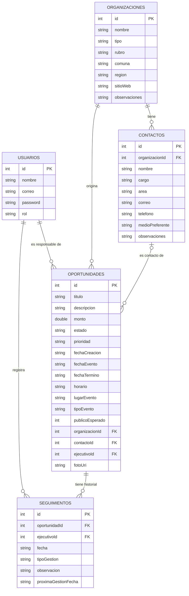

# Radar de Eventos

Aplicación móvil Android para gestionar oportunidades de activación y convenios corporativos: registrar eventos y organizaciones, asignarlos a un equipo comercial, darles seguimiento y detectar con anticipación cuáles requieren atención.

Proyecto desarrollado para la **Evaluación Parcial 2** de la asignatura **DSY1105 · Desarrollo de Aplicaciones Móviles** (Duoc UC), a partir del caso "Gestión móvil de oportunidades y activaciones corporativas".

## Integrantes

| Nombre |
|---|---|
| [Nombre Apellido 1] Axel Juris
| [Nombre Apellido 2] Cristobal Perez

- **Equipo N°:** 13
- **Sección / Sede:** 010D
- **Docente:** CHRISTIAN EDUARDO ACUNA SANDOVAL
- **Tablero Trello:**

## Contexto del problema

Una agencia de marketing y beneficios corporativos identifica eventos (ferias, jornadas de beneficios, actividades municipales, etc.) de forma manual, con información dispersa entre redes sociales, correos y registros personales. Eso provoca que muchas oportunidades se detecten tarde o se pierdan. La app centraliza el registro, la priorización y el seguimiento, y destaca lo próximo a ocurrir y lo atrasado.

## Funcionalidades implementadas

### Usuarios, roles y permisos
- Inicio y cierre de sesión con cuentas locales ficticias.
- Dos roles, con pantallas y opciones distintas: **Ejecutivo Comercial** y **Supervisor Comercial**.
- El ejecutivo ve solo las oportunidades asignadas a él. El supervisor ve todas.
- Control de sesión: si no hay usuario activo (por ejemplo, el sistema cerró la app en segundo plano), se vuelve al inicio de sesión.

### Oportunidades
- Crear y **editar** oportunidades con fecha, horario, lugar, tipo de evento, público esperado, prioridad y costo referencial ficticio.
- Asociación a una organización y, opcionalmente, a un contacto de esa organización.
- Lista con búsqueda por nombre u organización y filtros por **estado** y **prioridad**.
- Pantalla de detalle con la información completa y el historial de gestiones.
- Cambio de estado respetando permisos y transiciones (ver reglas de negocio).
- El supervisor asigna y reasigna oportunidades a ejecutivos.

### Organizaciones y contactos
- Registro de organizaciones y consulta de las ya registradas.
- Registro de contactos asociados a una organización (la organización, el área y el medio preferente se eligen de listas, así no se puede crear un contacto huérfano). Consulta de los contactos de cada organización.

### Seguimiento
- Registro de gestiones (llamada, reunión, correo, visita) con observación y fecha de la próxima gestión.
- Historial de gestiones por oportunidad, con su autor.

### Dashboard y panel del supervisor
- Dashboard en Inicio, según el rol: oportunidades activas, eventos próximos (14 días), seguimientos pendientes, **gestiones atrasadas** y oportunidades sin gestión.
- Panel del supervisor, con consulta global, carga por ejecutivo y oportunidades sin asignar. Es una pantalla restringida: un ejecutivo no puede acceder.

### Recursos nativos
- **Cámara:** captura de una foto como evidencia de la oportunidad, con vista previa. La foto se conserva asociada a su oportunidad.
- **Calendario:** agendar el evento (con fecha y hora) o una próxima gestión en el calendario del dispositivo.

## Reglas de negocio

**Transiciones de estado**

| Estado actual | Ejecutivo puede | Supervisor puede |
|---|---|---|
| Nueva | Iniciar gestión | Iniciar gestión, descartar |
| En gestión | Nada (no confirma ni descarta) | Confirmar, descartar |
| Confirmada / Descartada | Nada | Reabrir (vuelve a En gestión) |

**Edición de una oportunidad**
- El supervisor puede editar cualquiera.
- El ejecutivo solo puede editar las suyas, y únicamente mientras estén en estado Nueva o En gestión.

Estas reglas se comprueban en el ViewModel y no solo en la pantalla, para que no se puedan saltar desde la interfaz.

## Arquitectura

La app sigue el patrón **MVVM** con una capa de datos separada:

```
Pantalla (Composable)  ──observa──▶  ViewModel  ──usa──▶  Repository  ──usa──▶  DAO  ──▶  Room (SQLite)
      ▲                                  │
      └────────── UiState (StateFlow) ───┘
```

- **UI (`screens`, `components`):** composables que solo muestran el estado y avisan eventos al ViewModel. No contienen lógica de validación.
- **ViewModel (`viewmodel`):** guarda el estado de cada pantalla en un `UiState`, expuesto como `StateFlow`. Orquesta validaciones, permisos y llamadas al repositorio.
- **Validación (`validation`):** objetos independientes de la interfaz, con las reglas de cada formulario y las reglas de estado y permisos.
- **Repository (`data/CrmRepository`):** único punto de acceso a los datos.
- **Datos (`data`, `dataDao`):** entidades, DAOs y la base de datos Room.

### Estructura de carpetas

```
app/src/main/java/com/example/proyecto_evaluacion/
├── components/    Componentes reutilizables (campo validado, selector, barra superior, etiquetas)
├── data/          Entidades, base de datos, repositorio y sesión
├── dataDao/       DAOs de Room
├── fechas/        Utilidades de fechas, cámara (evidencias) y calendario
├── navegacion/    NavHost y rutas
├── screens/       Pantallas
├── ui/theme/      Colores, tipografía y tema
├── validation/    Validadores y reglas de negocio
└── viewmodel/     ViewModels y UiState
```

### Pantallas

| Pantalla | Descripción |
|---|---|
| Inicio de sesión | Acceso con cuenta local |
| Inicio (dashboard) | Resumen según el rol y accesos directos |
| Lista de oportunidades | Búsqueda y filtros |
| Detalle de oportunidad | Datos, estado, foto, calendario, asignación e historial |
| Formulario de oportunidad | Crear y editar |
| Formulario de organización | Registro y consulta |
| Formulario de contacto | Registro y consulta por organización |
| Panel del supervisor | Consulta global y asignación |

## Modelo de datos

La base de datos local (Room / SQLite) tiene 5 tablas relacionadas por claves foráneas.



**Decisiones de diseño**
- **Normalización (hasta 3FN):** cada dato de organización, contacto o usuario vive en una sola tabla y se referencia por su identificador. Una oportunidad no copia el nombre de la organización ni del ejecutivo, solo guarda sus claves.
- **Historial conservado:** las gestiones se guardan en su propia tabla y nunca se sobrescriben. Cada una conserva su autor y su fecha.
- **Contacto opcional:** una oportunidad pertenece a una organización, y el contacto es opcional. La interfaz solo ofrece los contactos de la organización elegida, por eso no pueden quedar inconsistentes.
- **Responsable opcional:** una oportunidad creada por el supervisor queda sin responsable hasta que la asigna. Por eso `ejecutivoId` admite valor nulo.
- **Fotos:** el archivo se guarda en el almacenamiento privado de la app (`filesDir/evidencias`) y la tabla guarda solo su ruta.

## Validaciones

Todas las reglas viven en el paquete `validation`, separadas de la interfaz:
- Campos obligatorios y longitudes mínimas y máximas.
- Formatos de correo, teléfono (9 a 11 dígitos), fecha (`dd/mm/aaaa` real, no solo con formato) y horario (`HH:mm`).
- Valores numéricos: público esperado mayor a 0 y costo no negativo.
- Reglas de negocio: la fecha de término no puede ser anterior a la de inicio, y la próxima gestión no puede ser anterior a hoy.

Cada campo muestra su mensaje bajo el campo, borde de error e ícono. Si falla una validación, los valores ingresados se mantienen.

## Diseño y animaciones

- **Jetpack Compose** con **Material Design 3**.
- Tema propio en `ui/theme` (turquesa, en modo claro y oscuro), sin color dinámico del sistema.
- Colores semánticos centralizados para los estados, las prioridades, el éxito y la advertencia. Las pantallas no usan colores hexadecimales.
- Jerarquía tipográfica con `MaterialTheme.typography`.
- Animaciones: `AnimatedVisibility` (mensajes y formularios), `animateColorAsState` (color del encabezado según el estado), `animateContentSize` y `animateItem` (tarjetas y listas).
- Estados vacíos, indicadores de carga y avisos de confirmación o error en cada operación.

## Tecnologías

| Tecnología | Uso |
|---|---|
| Kotlin | Lenguaje |
| Jetpack Compose y Material 3 | Interfaz |
| Navigation Compose | Navegación entre pantallas |
| ViewModel, `StateFlow` y corrutinas | Estado y operaciones asíncronas |
| Room (con KSP) | Persistencia local |
| Coil | Vista previa de las fotos |
| `FileProvider` y `TakePicture` | Cámara |
| `Intent` de calendario | Integración con el calendario |

Las versiones exactas están en `gradle/libs.versions.toml`.

## Cómo ejecutar el proyecto

**Requisitos**
- Android Studio reciente, con conexión a internet para la primera sincronización de Gradle.
- Un emulador o un celular Android con API 24 o superior.

**Pasos**
1. Clona el repositorio:
   ```
   git clone [URL del repositorio]
   ```
2. Abre la carpeta del proyecto en Android Studio y espera a que termine la sincronización de Gradle.
3. Selecciona un emulador o un celular conectado con depuración USB.
4. Presiona **Run**.

**Notas**
- La base de datos se crea en el primer uso, con las cuentas de prueba. Si cambias las entidades durante el desarrollo, desinstala la app antes de volver a ejecutarla.
- La cámara necesita un dispositivo o emulador con cámara, y el calendario necesita una app de calendario instalada. Si no la hay, la app muestra un aviso y no se cierra.
- La cámara usa la app de cámara del sistema, por eso la app no declara ni solicita el permiso de cámara.

## Cuentas de prueba

Todas usan la clave `clave123`.

| Correo | Nombre | Rol |
|---|---|---|
| supervisor@duoc.cl | Carlos Supervisor | Supervisor Comercial |
| ana@duoc.cl | Ana Ejecutivo | Ejecutivo Comercial |
| bruno@duoc.cl | Bruno Ejecutivo | Ejecutivo Comercial |
| carla@duoc.cl | Carla Ejecutivo | Ejecutivo Comercial |

## Flujo sugerido para probar la app

1. Entra como `ana@duoc.cl`. Registra una **organización** y un **contacto**.
2. Crea una **oportunidad** y ábrela desde "Mis oportunidades". Toma una **foto** y agéndala en el **calendario**.
3. Presiona **Iniciar gestión** y registra una **gestión** con próxima fecha.
4. Cierra sesión y entra como `supervisor@duoc.cl`. Abre la oportunidad y presiona **Confirmar participación**.
5. En el **Panel del supervisor**, asigna una oportunidad sin responsable a otro ejecutivo.
6. Entra como `bruno@duoc.cl` y comprueba que ve la oportunidad que le asignaron.

## Datos y privacidad

La app funciona **solo con información ficticia**: usuarios, organizaciones, contactos, costos y resultados de prueba. No se usan RUT, correos ni teléfonos reales, no se contacta a nadie desde la app y no se guarda ni se solicita la ubicación del usuario. Las contraseñas de las cuentas de prueba se guardan sin cifrar porque son ficticias y es un prototipo académico. En una versión real se almacenarían cifradas (hash).

## Alcance y trabajo futuro

Este proyecto es un **producto mínimo viable** académico, sin integraciones productivas. Como evolución se podría agregar:
- Consumo de una API REST con Retrofit y microservicios con Spring Boot.
- Notificaciones locales para recordar seguimientos y eventos próximos.
- Mapa con ubicaciones de los eventos y filtros por zona.
- Registro del resultado de la activación (asistentes, contactos generados, inscripciones) e indicadores generales.
- Cifrado de contraseñas y roles administrables.

## Control de versiones

El repositorio sigue commits técnicos con el formato `tipo: descripción` (`feat`, `fix`, `chore`) y la planificación de tareas se encuentra en Trello.
